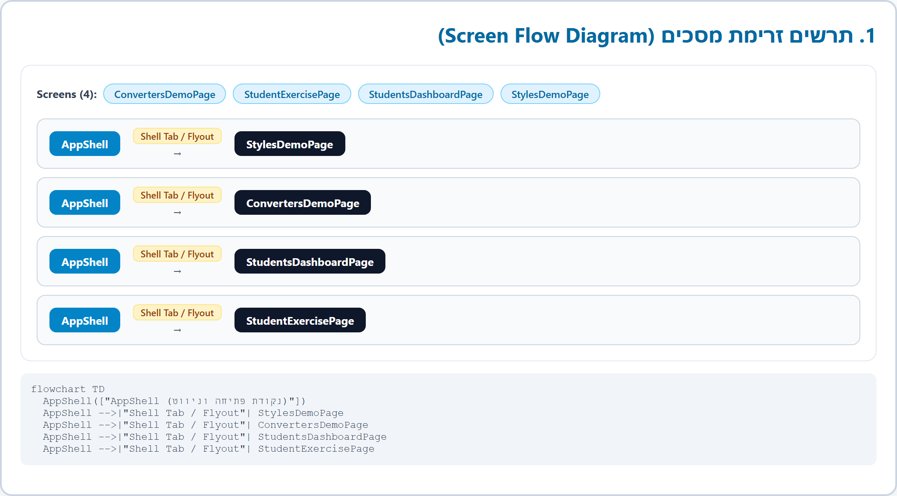
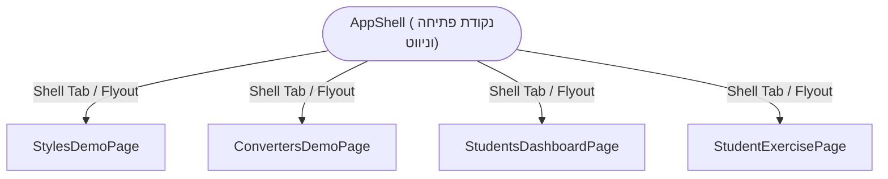
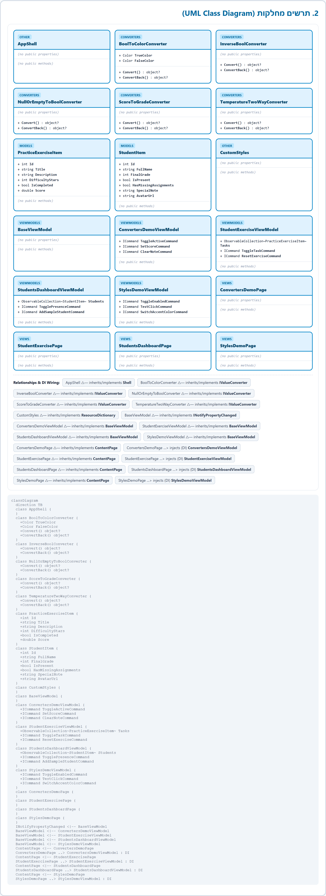

# תרשימי ארכיטקטורה ופרומפטים לתיק הפרויקט (883589)

קובץ זה נוצר אוטומטית מתוך קוד הפרויקט על ידי `Generate-Architecture-Diagrams.py`.
הוא מכיל את **תרשים זרימת המסכים (Screen Flow Diagram)** ואת **תרשים המחלקות (UML Class Diagram)** — כולל **תמונות PNG ויזואליות מוכנות** (`Learning/Images/Screen-Flow.png` ו-`Learning/Images/Architecture-UML.png`) — לשילוב בפרק **"מבנה / ארכיטקטורה של הפרויקט"** בתיק הפרויקט ובספר הלמידה (`MAUI-Learning-Book.pdf`).

---

## 1. תרשים זרימת מסכים (Screen Flow Diagram)

### פרומפט שמור ליצירת תרשים זרימת המסכים בעיצוב גרפי:
> צור תרשים זרימת מסכים (Screen Flow Diagram) נקי וברור עבור אפליקציית .NET MAUI. מסך הפתיחה וההיררכיה הראשיים מנוהלים ב-`AppShell`, והמסכים בפרויקט הם: `ConvertersDemoPage, StudentExercisePage, StudentsDashboardPage, StylesDemoPage`. הצג חיצים ברורים למעברי הניווט (`Shell.Current.GoToAsync`) בין המסכים לפי מבנה ה-Mermaid שלעיל.

---

## 2. תרשים מחלקות (UML Class Diagram)

```mermaid
classDiagram
  direction TB
  class AppShell {
  }
  class BoolToColorConverter {
    +Color TrueColor
    +Color FalseColor
    +Convert() object?
    +ConvertBack() object?
  }
  class InverseBoolConverter {
    +Convert() object?
    +ConvertBack() object?
  }
  class NullOrEmptyToBoolConverter {
    +Convert() object?
    +ConvertBack() object?
  }
  class ScoreToGradeConverter {
    +Convert() object?
    +ConvertBack() object?
  }
  class TemperatureTwoWayConverter {
    +Convert() object?
    +ConvertBack() object?
  }
  class PracticeExerciseItem {
    +int Id
    +string Title
    +string Description
    +int DifficultyStars
    +bool IsCompleted
    +double Score
  }
  class StudentItem {
    +int Id
    +string FullName
    +int FinalGrade
    +bool IsPresent
    +bool HasMissingAssignments
    +string SpecialNote
    +string AvatarUrl
  }
  class CustomStyles {
  }
  class BaseViewModel {
  }
  class ConvertersDemoViewModel {
    +ICommand ToggleActiveCommand
    +ICommand SetScoreCommand
    +ICommand ClearNoteCommand
  }
  class StudentExerciseViewModel {
    +ObservableCollection~PracticeExerciseItem~ Tasks
    +ICommand ToggleTaskCommand
    +ICommand ResetExerciseCommand
  }
  class StudentsDashboardViewModel {
    +ObservableCollection~StudentItem~ Students
    +ICommand TogglePresenceCommand
    +ICommand AddSampleStudentCommand
  }
  class StylesDemoViewModel {
    +ICommand ToggleEnabledCommand
    +ICommand TestClickCommand
    +ICommand SwitchAccentColorCommand
  }
  class ConvertersDemoPage {
  }
  class StudentExercisePage {
  }
  class StudentsDashboardPage {
  }
  class StylesDemoPage {
  }
  INotifyPropertyChanged <|-- BaseViewModel
  BaseViewModel <|-- ConvertersDemoViewModel
  BaseViewModel <|-- StudentExerciseViewModel
  BaseViewModel <|-- StudentsDashboardViewModel
  BaseViewModel <|-- StylesDemoViewModel
  ContentPage <|-- ConvertersDemoPage
  ConvertersDemoPage ..> ConvertersDemoViewModel : DI
  ContentPage <|-- StudentExercisePage
  StudentExercisePage ..> StudentExerciseViewModel : DI
  ContentPage <|-- StudentsDashboardPage
  StudentsDashboardPage ..> StudentsDashboardViewModel : DI
  ContentPage <|-- StylesDemoPage
  StylesDemoPage ..> StylesDemoViewModel : DI
```

### פרומפט שמור ליצירת תרשים ה-UML בעיצוב גרפי:
> צור תרשים מחלקות UML תקני (UML Class Diagram) המחולק לשכבות MVVM (`Models`, `Services`, `ViewModels`, `Views`) עבור פרויקט ה-.NET MAUI, כולל קשרי ירושה (`<|--`), הכלה, והזרקת תלויות בבנאי (`..> DI`), בהתבסס על הגדרת ה-Mermaid שלעיל.
