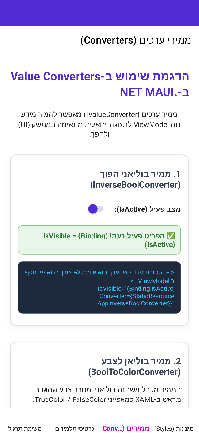
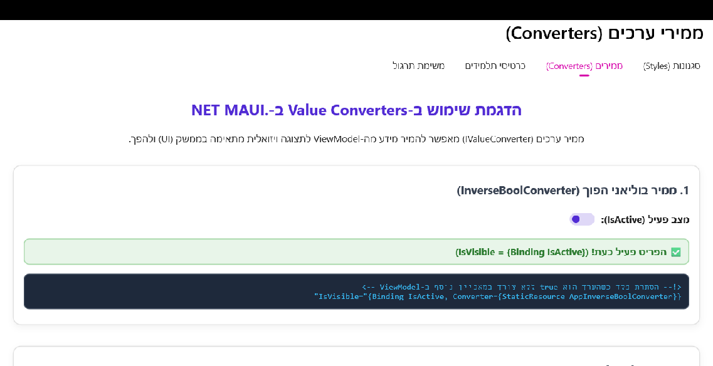

# מדריך צעד-אחר-צעד: עבודה עם Value Converters ב-.NET MAUI

## 📸 תצוגת מסך חיה: Android מול Windows (DevFlow Live Capture)

| Android Mobile (Pixel 9) | Windows Desktop (WinUI 3) |
| :---: | :---: |
|  |  |

## 🎯 מבוא ומטרת המדריך
במדריך זה נלמד כיצד לממש ולהשתמש ב-**ממירי ערכים (Value Converters)** ב-.NET MAUI בארכיטקטורת MVVM.

### מהו Value Converter?
ממיר ערכים הוא מחלקה המממשת את הממשק `IValueConverter`. תפקידו לקחת ערך גולמי שמגיע מה-ViewModel (למשל מספר, בוליאן, תאריך), ולהמיר אותו לתצוגה ויזואלית שמתאימה לפקד ב-UI (למשל צבע, טקסט מילולי, מצב נראות).

### 💡 שאלת מפתח: למה לא לעשות את ההמרה בתוך ה-ViewModel?
* **עיקרון הפרדת האחריות (Separation of Concerns)**: ה-ViewModel אמור להיות נקי ממושגי תצוגה גרפיים (כמו `Color`, `FontImageSource`). אסור ל-ViewModel "לדעת" שציון 90 מוצג בצבע ירוק או כחול.
* **שימוש חוזר (Reusability)**: אותו ממיר יכול לשמש עשרות מסכים ופקדים שונים בכל הפרויקט.

---

## 🔍 מבנה הממשק `IValueConverter`

הממשק מכיל שתי שיטות עיקריות:

```csharp
public interface IValueConverter
{
    // המרה מכיוון ה-ViewModel (מקור הנתונים) אל ה-UI (היעד)
    object? Convert(object? value, Type targetType, object? parameter, CultureInfo culture);

    // המרה הפוכה מכיוון ה-UI חזרה אל ה-ViewModel (משמש בעיקר ב-TwoWay Binding)
    object? ConvertBack(object? value, Type targetType, object? parameter, CultureInfo culture);
}
```

### הסבר הפרמטרים:
* `value`: הערך הגולמי שנשלח מה-Property ב-ViewModel (או מפקד אחר).
* `targetType`: סוג הנתונים שה-UI מצפה לקבל (למשל `typeof(Color)` או `typeof(bool)`).
* `parameter`: מידע נוסף שמועבר מה-XAML דרך `ConverterParameter`.
* `culture`: מידע על שפת המכשיר והגדרות אזוריות (שימושי לעיצוב מטבע, תאריכים ומספרים).

---

## 🛠️ שלב 1: יצירת מחלקת Converter ב-C#

ניצור תיקייה ייעודית בשם `Converters/`, ובתוכה נפתח קובץ חדש:

### דוגמה 1: ממיר בוליאני הפוך (InverseBoolConverter)
```csharp
using System;
using System.Globalization;
using Microsoft.Maui.Controls;

namespace LearnStylesMaui.Converters
{
    public class InverseBoolConverter : IValueConverter
    {
        public object? Convert(object? value, Type targetType, object? parameter, CultureInfo culture)
        {
            if (value is bool boolVal)
            {
                return !boolVal; // היפוך הערך
            }
            return false;
        }

        public object? ConvertBack(object? value, Type targetType, object? parameter, CultureInfo culture)
        {
            if (value is bool boolVal)
            {
                return !boolVal;
            }
            return false;
        }
    }
}
```

### דוגמה 2: ממיר ציון לטקסט מילולי או צבע עם ConverterParameter
```csharp
public class ScoreToGradeConverter : IValueConverter
{
    public object? Convert(object? value, Type targetType, object? parameter, CultureInfo culture)
    {
        double score = value is double d ? d : (value is int i ? i : 0);

        // בדיקה האם הועבר פרמטר "Color"
        if (parameter is string p && p.Equals("Color", StringComparison.OrdinalIgnoreCase))
        {
            if (score >= 90) return Color.FromArgb("#2E7D32"); // Green
            if (score >= 70) return Color.FromArgb("#1976D2"); // Blue
            return Color.FromArgb("#D32F2F"); // Red
        }

        // אם לא הועבר פרמטר, נחזיר הערכה מילולית
        if (score >= 90) return "מצוין (A)";
        if (score >= 80) return "טוב מאוד (B)";
        if (score >= 70) return "טוב (C)";
        return "טעון שיפור";
    }

    public object? ConvertBack(object? value, Type targetType, object? parameter, CultureInfo culture)
    {
        throw new NotImplementedException();
    }
}
```

---

## 📦 שלב 2: רישום ה-Converter ב-XAML

כדי שנוכל להשתמש ב-Converter ב-XAML, עלינו להגדיר אותו כמשאב (Resource).

### א. ייבוא ה-Namespace בראש קובץ ה-XAML:
```xml
xmlns:converters="clr-namespace:LearnStylesMaui.Converters"
```

### ב. רישום במילון המשאבים (ברמת הדף או ב-`App.xaml` לשימוש כללי):
```xml
<ContentPage.Resources>
    <ResourceDictionary>
        <!-- יצירת מופע של הממיר עם מפתח x:Key -->
        <converters:InverseBoolConverter x:Key="InverseBoolConverter" />
        <converters:ScoreToGradeConverter x:Key="ScoreToGradeConverter" />
    </ResourceDictionary>
</ContentPage.Resources>
```

---

## 🔗 שלב 3: שימוש ב-Binding

כעת נקשר את הממיר לכל מאפיין שנרצה באמצעות מילת המפתח `Converter`:

```xml
<!-- שימוש בממיר בוליאני הפוך כדי להציג הודעה כאשר אין חיבור לרשת -->
<Label Text="אין חיבור לאינטרנט!"
       IsVisible="{Binding IsConnected, Converter={StaticResource InverseBoolConverter}}" />

<!-- המרת ציון לטקסט מילולי -->
<Label Text="{Binding Score, Converter={StaticResource ScoreToGradeConverter}}" />

<!-- המרת אותו ציון לצבע רקע בעזרת ConverterParameter="Color" -->
<Border BackgroundColor="{Binding Score, 
        Converter={StaticResource ScoreToGradeConverter}, 
        ConverterParameter='Color'}">
    <Label Text="תגית הישג" />
</Border>
```

---

## 🔄 שלב 4: ממיר דו-כיווני (Two-Way Converter ו-ConvertBack)

ברוב המקרים ממיר עובד בכיוון אחד: מה-ViewModel אל המסך.
אך מה קורה כאשר המשתמש עורך נתון ב-`Entry` ורוצים שהערך יומר חזרה ויישמר ב-ViewModel?
לשם כך מממשים את מתודת `ConvertBack` ומגדירים ב-Binding את המאפיין `Mode=TwoWay`.

### דוגמה: המרת מעלות צלזיוס (°C ב-ViewModel) לפרנהייט (°F ב-UI):
* **`Convert`**: `(celsius * 9/5) + 32` -> מוצג למשתמש ב-Entry כ-°F.
* **`ConvertBack`**: `(fahrenheit - 32) * 5/9` -> מומר חזרה לצלזיוס ונשמר ב-ViewModel!

```xml
<Entry Text="{Binding CelsiusTemp, Mode=TwoWay, Converter={StaticResource TemperatureConverter}}" />
```

---

## ❓ שאלות חזרה לבחינת בגרות (בעל-פה)

1. **שאלה**: מה ההבדל בין `Convert` ל-`ConvertBack`?
   * **תשובה**: `Convert` מעביר וממיר ערך ממקור הנתונים (ViewModel) אל פקד התצוגה (View). `ConvertBack` מבצע את הפעולה ההפוכה כאשר המשתמש משנה את הערך בממשק והנתון נשמר חזרה במודל.
2. **שאלה**: לשם מה נועד ה-`ConverterParameter`?
   * **תשובה**: להעביר מידע או הוראה נוספת לממיר מתוך ה-XAML (למשל לקבוע האם להחזיר טקסט או צבע, או לקבוע את פורמט התאריך הרצוי).
3. **שאלה**: מדוע עדיף להמיר ערך בוליאני לצבע באמצעות Converter ולא להחזיק Property מסוג `Color` ישירות ב-ViewModel?
   * **תשובה**: כדי לשמור על עקרון MVVM הטהור. ה-ViewModel אינו אמור להכיל פקדים או טיפוסי UI גרפיים (כגון `Color`), אלא נתונים לוגיים בלבד.
