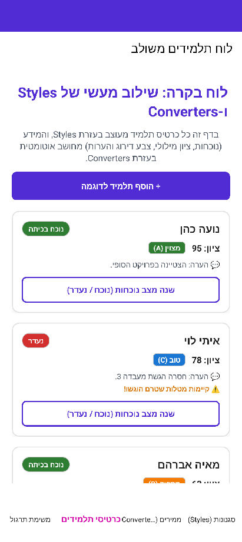
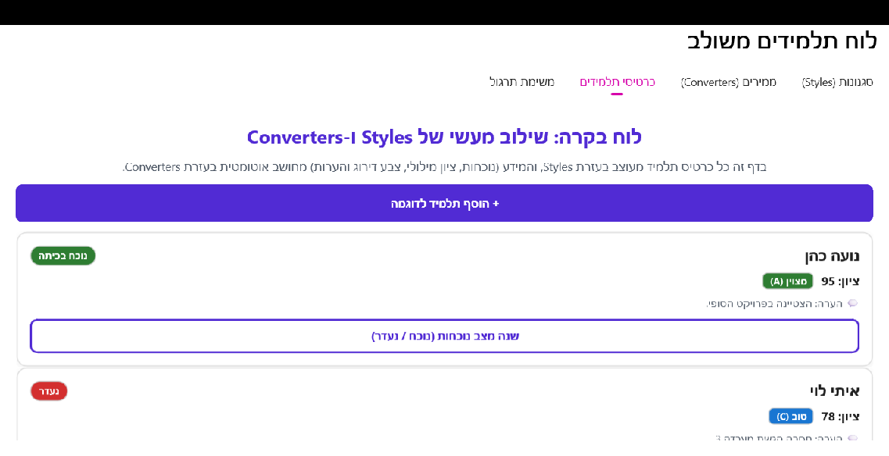
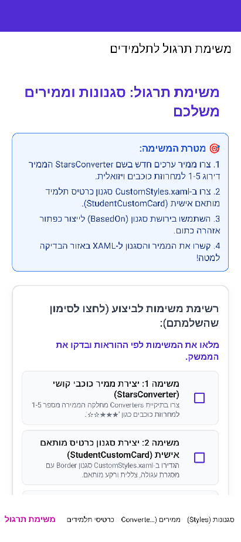
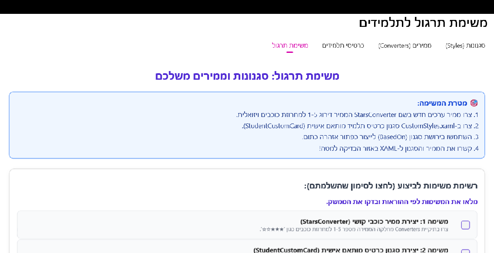

# דף משימת תרגול לתלמידים: עיצוב וממירים ב-.NET MAUI

**שם הפרויקט**: `LearnStylesMaui`  
**נושא**: שימוש מתקדם ב-Styles ויצירת Value Converters  
**קהל יעד**: תלמידי מגמת הנדסת תוכנה (5 יח"ל לבגרות)  

## 📸 תצוגת מסכי האפליקציה ב-Android וב-Windows

| לוח תלמידים (Android) | לוח תלמידים (Windows) |
| :---: | :---: |
|  |  |

| מסך משימת תרגול (Android) | מסך משימת תרגול (Windows) |
| :---: | :---: |
|  |  |

---

## 🎯 מטרת המשימה
במשימה זו תתנסו באופן מעשי ביצירת סגנונות מותאמים אישית (Styles), ירושת סגנונות (BasedOn), ופיתוח ממיר ערכים (IValueConverter) חדש. בסיום המשימה תבדקו את התוצאות שלכם ישירות במסך **"משימת תרגול"** באפליקציה!

---

## 📋 פירוט המשימות (שלב אחר שלב)

### משימה 1: יצירת ממיר דירוג כוכבים (`StarsConverter`)
1. פתחו את התיקייה `Converters/` בפרויקט.
2. צרו קובץ C# חדש בשם `StarsConverter.cs`.
3. ממשו את הממשק `IValueConverter`.
4. בתוך המתודה `Convert`:
   * קבלו את הערך המספרי של הכוכבים (1 עד 5).
   * החזירו מחרוזת כוכבים בהתאם (למשל: עבור ערך 3 החזירו `"★★★☆☆"`, עבור 5 החזירו `"★★★★★"`).
   * טפלו במקרה של ערך שגוי או `null` והחזירו `"☆☆☆☆☆"`.
5. רשמו את הממיר ב-`App.xaml` או ב-`StudentExercisePage.xaml` במילון המשאבים:
   ```xml
   <converters:StarsConverter x:Key="StarsConverter" />
   ```

---

### משימה 2: יצירת סגנון כרטיס תלמיד מותאם אישית (`StudentCustomCard`)
1. פתחו את הקובץ `Resources/Styles/CustomStyles.xaml`.
2. הגדירו סגנון חדש מסוג `Border` עם המפתח `x:Key="StudentCustomCard"`:
   * מסגרת מעוגלת (`StrokeShape="RoundRectangle 16"`).
   * צבע רקע מיוחד (למשל צבע רקע בהיר `#F0FDF4`).
   * עובי מסגרת (`StrokeThickness="2"`).
   * צבע מסגרת תואם (`Stroke="#86EFAC"`).
   * צללית מודרנית (`Shadow`).

---

### משימה 3: ירושת סגנון (Style Inheritance) לכפתור אזהרה
1. בדקו את הסגנון הקיים `PrimaryButton` ב-`CustomStyles.xaml`.
2. ודאו שקיים או צרו סגנון בשם `WarningButton` שיורש באמצעות `BasedOn="{StaticResource PrimaryButton}"`.
3. דרסו אך ורק את צבע הרקע (`BackgroundColor`) לצבע אזהרה כתום (למשל `#EA580C`).

---

### משימה 4: חיבור הממיר והסגנון במסך התרגול (`StudentExercisePage.xaml`)
1. פתחו את `Views/StudentExercisePage.xaml`.
2. אתרו את כרטיס התצוגה של התלמיד (חפשו את הערות ה-`TODO`).
3. החליפו את ה-Style של הכרטיס לסגנון שיצרתם:
   ```xml
   <Border Style="{StaticResource StudentCustomCard}">
   ```
4. קשרו את ה-Label של כוכבי הדירוג לממיר שיצרתם:
   ```xml
   <Label Text="{Binding DifficultyStars, Converter={StaticResource StarsConverter}}" />
   ```
5. הריצו את האפליקציה, שנו את ה-Stepper של הכוכבים ובדקו שהכוכבים מתעדכנים מיידית על המסך!

---

## 🏆 מחוון הערכה למורה (Rubric)

| קריטריון | ניקוד | פירוט |
| :--- | :---: | :--- |
| **מימוש StarsConverter** | 30% | מימוש תקין של `IValueConverter`, בדיקת טיפוסים, החזרת מחרוזת כוכבים נכונה וטיפול בערכי קצה. |
| **הגדרת סגנון כרטיס** | 25% | הגדרת סגנון מפורש ב-`ResourceDictionary` עם תכונות ויזואליות עשירות. |
| **ירושת סגנון (BasedOn)** | 20% | שימוש מדויק ב-`BasedOn` ללא שכפול תכונות שכבר קיימות בסגנון האב. |
| **חיבור ב-XAML וריצה תקינה** | 15% | קישור נכון של `Converter={StaticResource ...}` ו-`Style={StaticResource ...}`. |
| **הסבר בעל-פה / שאלות הבנה** | 10% | מתן תשובות נכונות לשאלות הבוחן בנושא סגנונות וממירים. |

---

## 💬 שאלות לבדיקת הבנה בעל-פה (שאלות בוחן בגרות)
1. מדוע השתמשנו ב-`IValueConverter` כדי להמיר את מספר הכוכבים למחרוזת כוכבים במקום לכתוב פונקציה ב-ViewModel?
2. מה היה קורה אילו היינו מגדירים את ה-Style של הכרטיס ללא `x:Key`? האם זה היה משפיע על כרטיסים אחרים באפליקציה?
3. אם נשנה את ה-`CornerRadius` בסגנון האב `PrimaryButton`, האם גם `WarningButton` ישתנה? מדוע?
