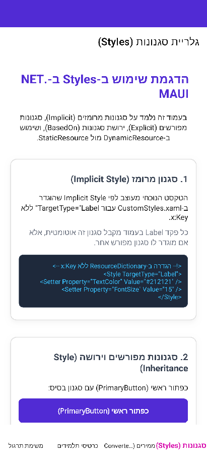
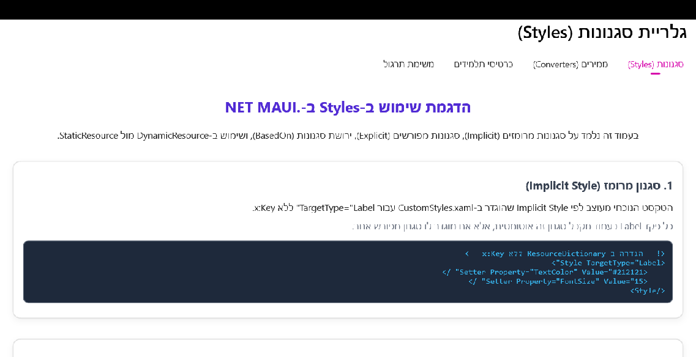

# מדריך צעד-אחר-צעד: עבודה עם Styles ב-.NET MAUI

## 📸 תצוגת מסך חיה: Android מול Windows (DevFlow Live Capture)

| Android Mobile (Pixel 9) | Windows Desktop (WinUI 3) |
| :---: | :---: |
|  |  |

## 🎯 מבוא ומטרת המדריך
במדריך זה נלמד כיצד לעצב יישומי .NET MAUI בצורה מקצועית, נקייה ומודולרית באמצעות **סגנונות (Styles)**.

### מדוע משתמשים ב-Styles?
1. **עיקרון DRY (Don't Repeat Yourself)**: במקום להעתיק הגדרות צבע, גופן ומרווחים שוב ושוב עבור כל כפתור או תווית, מגדירים את העיצוב במקום מרכזי אחד.
2. **אחידות ממשקית (UI Consistency)**: כל הכפתורים הראשיים באפליקציה ייראו תמיד אותו דבר, ושינוי אחד ישפיע על כל האפליקציה.
3. **הפרדת תפקידים נקייה**: הפרדה בין מבנה המסך והנתונים (Data) לבין סגנון התצוגה הוויזואלי.

---

## 📍 שלב 1: איפה מגדירים סגנונות? (Resource Scopes)

ב-.NET MAUI ניתן להגדיר סגנונות בארבע רמות שונות (מהכללית לספציפית ביותר):

1. **רמה אפליקטיבית (Global / App-Level)**:
   * מוגדר בתוך `App.xaml` או בקובץ `ResourceDictionary` נפרד (כגון `CustomStyles.xaml`) שממוזג ב-`App.xaml`.
   * **זמינות**: בכל רחבי האפליקציה, בכל הדפים והפקדים.
2. **רמת העמוד (Page-Level)**:
   * מוגדר בתוך `<ContentPage.Resources>`.
   * **זמינות**: רק בתוך אותו עמוד ספציפי.
3. **רמת מכל/פריסה (Layout-Level)**:
   * מוגדר בתוך `<StackLayout.Resources>` או `<Grid.Resources>`.
   * **זמינות**: רק עבור הפקדים המוכלים בתוך אותה פריסה.
4. **רמת הפקד הבודד (Inline Properties)**:
   * הגדרה ישירה על גבי הפקד (למשל `BackgroundColor="Red"`).
   * **כלל דריסה**: הגדרה ישירה בפקד דורסת כל הגדרה שמגיעה מ-Style!

---

## 🎨 שלב 2: סגנון מרומז (Implicit Style)

סגנון מרומז הוא סגנון המוגדר **ללא מאפיין `x:Key`**.

### אופן הפעולה:
כל פקד מסוג `TargetType` שנמצא בטווח (Scope) של מילון המשאבים יקבל את הסגנון הזה באופן אוטומטי, מבלי שנצטרך לציין `Style="{...}"`!

### דוגמת קוד:
```xml
<!-- הגדרת סגנון מרומז לכל ה-Labels -->
<Style TargetType="Label">
    <Setter Property="TextColor" Value="#212121" />
    <Setter Property="FontSize" Value="15" />
    <Setter Property="FontFamily" Value="OpenSansRegular" />
</Style>
```

### שימוש ב-XAML:
```xml
<!-- ה-Label יקבל אוטומטית TextColor=#212121 ו-FontSize=15 -->
<Label Text="שלום כיתה!" />
```

---

## 🏷️ שלב 3: סגנון מפורש (Explicit Style)

סגנון מפורש הוא סגנון המוגדר **עם מאפיין `x:Key`**.

### אופן הפעולה:
הוא אינו חל אוטומטית על פקדים, אלא מופעל רק כאשר פקד מציין אותו במפורש באמצעות המאפיין `Style="{StaticResource MyKey}"`.

### דוגמת קוד:
```xml
<!-- הגדרת סגנון מפורש לכפתור ראשי -->
<Style x:Key="PrimaryButton" TargetType="Button">
    <Setter Property="BackgroundColor" Value="#512BD4" />
    <Setter Property="TextColor" Value="White" />
    <Setter Property="FontAttributes" Value="Bold" />
    <Setter Property="CornerRadius" Value="8" />
    <Setter Property="HeightRequest" Value="48" />
</Style>
```

### שימוש ב-XAML:
```xml
<Button Text="התחבר למערכת"
        Style="{StaticResource PrimaryButton}" />
```

---

## 🌳 שלב 4: ירושת סגנונות בעזרת `BasedOn` (Style Inheritance)

בדיוק כפי שמחלקה ב-C# יכולה לרשת ממחלקת בסיס, סגנון ב-XAML יכול לרשת את כל המאפיינים (Setters) של סגנון אחר, ולהוסיף או לדרוס מאפיינים בודדים.

### דוגמת קוד:
```xml
<!-- סגנון SuccessButton יורש מ-PrimaryButton ומשנה רק את צבע הרקע -->
<Style x:Key="SuccessButton" TargetType="Button" BasedOn="{StaticResource PrimaryButton}">
    <Setter Property="BackgroundColor" Value="#2E7D32" />
</Style>

<!-- סגנון DangerButton יורש מ-PrimaryButton עבור מחיקה -->
<Style x:Key="DangerButton" TargetType="Button" BasedOn="{StaticResource PrimaryButton}">
    <Setter Property="BackgroundColor" Value="#D32F2F" />
</Style>
```

> **יתרון עצום לתלמידים**: אם נרצה בעתיד לשנות את הרדיוס של כל הכפתורים מ-8 ל-12, נשנה את `CornerRadius` רק ב-`PrimaryButton`, וכל הכפתורים היורשים יתעדכנו אוטומטית!

---

## ⚡ שלב 5: `StaticResource` לעומת `DynamicResource`

זוהי אחת משאלות הבגרות הנפוצות ביותר:

| מאפיין | `StaticResource` | `DynamicResource` |
| :--- | :--- | :--- |
| **זמן טעינה** | נטען פעם אחת בלבד בעת יצירת הפקד/הדף. | מקושר באופן דינמי ונשאר "בהאזנה" לשינויים במילון. |
| **ביצועים** | מהיר מאוד ויעיל בזיכרון. | מעט איטי יותר עקב מנגנון הניטור הדינמי. |
| **שינוי בזמן ריצה** | לא מתעדכן אם ערך המשאב משתנה לאחר הטעינה. | מתעדכן מיד על המסך אם המשאב שונה בקוד C#. |
| **שימוש אופייני** | גופנים, גדלים, מרווחים, צבעים קבועים. | החלפת ערכות נושא (Themes: Light/Dark), צבע הדגשה מותאם אישית. |

### דוגמת עדכון DynamicResource מתוך C#:
```csharp
// בעת לחיצה על כפתור החלפת נושא:
Application.Current.Resources["DynamicAccentColor"] = Color.FromArgb("#00897B");
```

ב-XAML:
```xml
<Button Text="אישור" BackgroundColor="{DynamicResource DynamicAccentColor}" />
```

---

## 🎛️ שלב 6: שימוש ב-`VisualStateManager` בתוך סגנון

מאפשר לשנות את תכונות הפקד בהתאם למצבו:
* `Normal`: מצב ברירת מחדל.
* `Disabled`: מצב שבו הפקד מושבת (`IsEnabled=false`).
* `Pressed`: מצב שבו המשתמש לוחץ על הכפתור.

```xml
<Style x:Key="InteractiveButtonStyle" TargetType="Button" BasedOn="{StaticResource PrimaryButton}">
    <Setter Property="VisualStateManager.VisualStateGroups">
        <VisualStateGroupList>
            <VisualStateGroup x:Name="CommonStates">
                <VisualState x:Name="Normal">
                    <VisualState.Setters>
                        <Setter Property="Opacity" Value="1.0" />
                    </VisualState.Setters>
                </VisualState>
                <VisualState x:Name="Disabled">
                    <VisualState.Setters>
                        <Setter Property="BackgroundColor" Value="#9E9E9E" />
                        <Setter Property="TextColor" Value="#E0E0E0" />
                        <Setter Property="Opacity" Value="0.6" />
                    </VisualState.Setters>
                </VisualState>
            </VisualStateGroupList>
        </VisualStateGroupList>
    </Setter>
</Style>
```

---

## ❓ שאלות חזרה לבחינת בגרות (בעל-פה)
1. **שאלה**: מה ההבדל בין סגנון מרומז (Implicit) לסגנון מפורש (Explicit)?
   * **תשובה**: סגנון מרומז מוגדר ללא `x:Key` ומוחל אוטומטית על כל הפקדים מאותו סוג. סגנון מפורש כולל `x:Key` ויש לשייך אותו ידנית באמצעות `Style="{StaticResource ...}"`.
2. **שאלה**: מדוע כדאי להשתמש ב-`BasedOn`?
   * **תשובה**: כדי למנוע כפילות קוד (DRY) ולאפשר ירושת מאפיינים משותפים מכפתור בסיס.
3. **שאלה**: מתי חובה להשתמש ב-`DynamicResource` במקום `StaticResource`?
   * **תשובה**: כאשר ערך המשאב (כגון צבע) עשוי להשתנות בזמן ריצת התוכנית (למשל במעבר בין Dark Mode ל-Light Mode).
