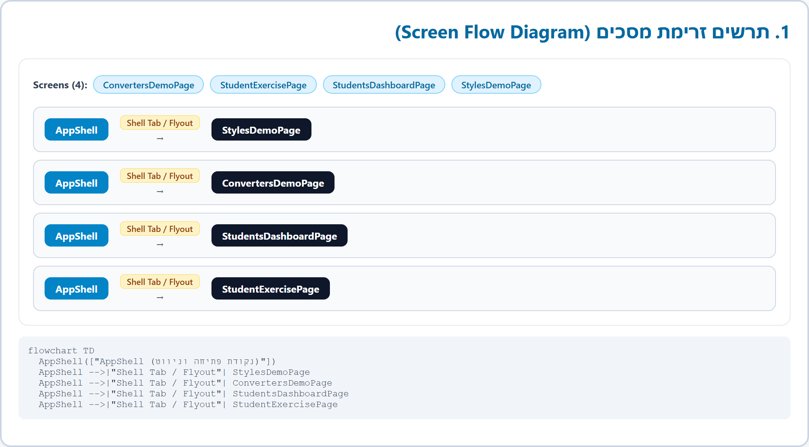
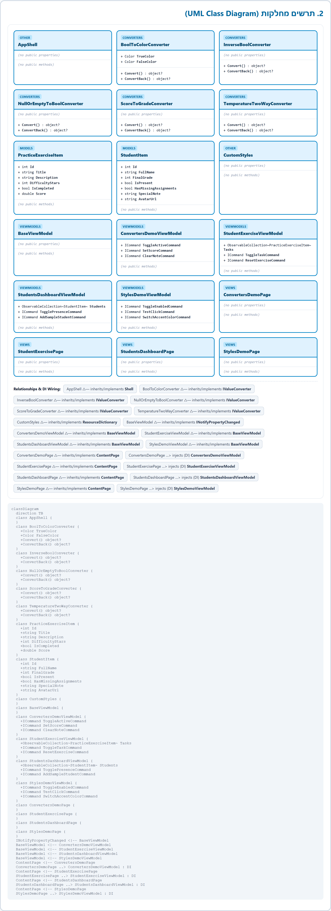

# MAUI Learning Book

This is the student's append-only learning book.

Each meaningful code change should add a compact lesson that explains:
- what changed
- why it changed
- what MAUI/C# concept was learned
- reference docs online to read more and learn
- how to verify the work
- one or two check questions

Always write explanations and lessons in this learning book in **Hebrew** while keeping C#, XAML, and .NET code identifiers in **English**.

---

## פרק 1: סגנונות וממירי ערכים ב-.NET MAUI (Styles and Value Converters)

### 📌 מה השתנה בפרויקט?
1. הוקמה תשתית סגנונות מודולרית בקובץ `Resources/Styles/CustomStyles.xaml` הממוזגת במילון המשאבים הראשי ב-`App.xaml`.
2. נוצרו חמישה ממירי ערכים מותאמים אישית (`Converters/`):
   - `InverseBoolConverter`: היפוך בוליאני לנראות אלמנטים (`IsVisible`).
   - `BoolToColorConverter`: המרת מצב בוליאני לצבע עם הגדרת צבעים מותאמת ב-XAML.
   - `ScoreToGradeConverter`: המרת ציון מספרי לטקסט מילולי או צבע תואם באמצעות `ConverterParameter`.
   - `TemperatureTwoWayConverter`: ממיר דו-כיווני המדגים שימוש ב-`Convert` וב-`ConvertBack` בעת `Mode=TwoWay`.
   - `NullOrEmptyToBoolConverter`: בדיקת תוכן מחרוזת להצגת התראות ולידציה.
3. הוגדרו ארבעה מסכים אינטראקטיביים ב-`Views/` עם ViewModels מתאימים בארכיטקטורת Vanilla C# MVVM:
   - `StylesDemoPage`: הדגמת Implicit, Explicit, BasedOn, DynamicResource ו-VisualStateManager.
   - `ConvertersDemoPage`: בדיקת כל ממירי הערכים עם פקדי קלט פעילים.
   - `StudentsDashboardPage`: לוח כרטיסי תלמידים המשלב Styles ו-Converters יחד.
   - `StudentExercisePage`: מסך משימת תרגול אינטראקטיבי עבור התלמיד.
4. נכתבו שלושה מדריכים מקיפים ב-`Learning/Guides/`:
   - [מדריך צעד-אחר-צעד לסגנונות](file:///c:/Users/Owner/source/repos/LearnStylesMaui/Learning/Guides/StylesDemo-Guide.md)
   - [מדריך צעד-אחר-צעד לממירי ערכים](file:///c:/Users/Owner/source/repos/LearnStylesMaui/Learning/Guides/ConvertersDemo-Guide.md)
   - [דף משימת תרגול ומחוון הערכה](file:///c:/Users/Owner/source/repos/LearnStylesMaui/Learning/Guides/Student-Practice-Assignment.md)

### 💡 מדוע זה השתנה?
כדי לספק לתלמידים פרויקט הדגמה חי, מוחשי ומוכן לבגרות, המדגים כיצד לשמור על עקרון DRY (Don't Repeat Yourself), כיצד להפריד נתונים מתצוגה (MVVM), וכיצד לענות על שאלות בוחן בגרות בעל-פה בנושא XAML ו-Data Binding.

### 🧠 מושגי יסוד שנלמדו:
1. **Implicit Style**: סגנון ברירת מחדל לפקד ללא `x:Key` החל על כל הפקדים מאותו סוג.
2. **Explicit Style**: סגנון ספציפי בעל `x:Key` המופעל באמצעות `Style="{StaticResource ...}"`.
3. **Style Inheritance (`BasedOn`)**: ירושת סגנון המאפשרת לדרוס רק תכונות בודדות מכפתור בסיס.
4. **DynamicResource לעומת StaticResource**: `StaticResource` נקבע חד-פעמית בטעינה; `DynamicResource` מאזין לשינויים בזמן ריצה (למשל החלפת צבע ערכת נושא).
5. **VisualStateManager**: ניהול תצוגת הפקד במצבים שונים (`Normal`, `Disabled`, `Pressed`).
6. **IValueConverter**: ממשק המאפשר המרת מידע גולמי מה-ViewModel לתצוגה גרפית ב-UI דרך `Convert`, והמרה חוזרת מה-UI למודל דרך `ConvertBack`.

### 📚 מקורות לימוד רשמיים:
- [Microsoft Learn: Style apps using XAML](https://learn.microsoft.com/en-us/dotnet/maui/user-interface/styles/xaml?view=net-maui-10.0)
- [Microsoft Learn: Binding value converters](https://learn.microsoft.com/en-us/dotnet/maui/fundamentals/data-binding/converters?view=net-maui-10.0)
- [Microsoft Learn: VisualStateManager](https://learn.microsoft.com/en-us/dotnet/maui/user-interface/visual-states?view=net-maui-10.0)

### ❓ שאלות הבנה לבדיקה עצמית:
1. מדוע מחלקת `InverseBoolConverter` צריכה לבדוק `if (value is bool boolVal)` ולא לבצע ישירות `!(bool)value`?  
   * **תשובה**: הגנה מפני קריסה (NullReferenceException או InvalidCastException) במקרה שבו נשלח ערך null או טיפוס בלתי צפוי בזמן אתחול ה-Binding.
2. מתי נשתמש ב-`ConverterParameter`?  
   * **תשובה**: כאשר אנו רוצים להעביר נתון קבוע נוסף מתוך ה-XAML אל פעולת ההמרה (לדוגמה: להורות לממיר הציון האם להחזיר טקסט מילולי או צבע).

---

## פרק 2: תרשימי ארכיטקטורה, זרימת מסכים ו-UML

פרק זה מציג את המבנה הארכיטקטוני של הפרויקט כתרשימים ויזואליים (חלק מפרק הארכיטקטורה בתיק הבגרות 883589).

### 1. תרשים זרימת מסכים וניווט (Screen Flow Diagram)
תרשים זה ממחיש כיצד ה-`AppShell` מנהל את הניווט הראשי בין ארבעת מסכי הפרויקט:



### 2. תרשים מחלקות (UML Class Diagram)
תרשים המחלקות ממחיש את המבנה ההיררכי של הפרויקט: מחלקות ה-Models, ה-ViewModels (היורשים מ-`BaseViewModel`), ממירי הערכים (המממשים `IValueConverter`) וה-Views:



---

## פרק 3: ארגון ה-DI Container בתבנית Fluent Extension Methods ב-`MauiProgram.cs`

### 📌 מה השתנה בפרויקט?
מחלקת האתחול `MauiProgram` בקובץ `LearnStylesMaui/MauiProgram.cs` עברה ארגון מחדש (Refactoring) מתודת `CreateMauiApp` ארוכה לתבנית **Fluent Interface** נקייה ומודולרית באמצעות מתודות הרחבה (`Extension Methods`) על `MauiAppBuilder`:
- `RegisterFonts(this MauiAppBuilder builder)`: רישום הגופנים של האפליקציה (`OpenSansRegular`, `OpenSansSemibold`).
- `RegisterServices(this MauiAppBuilder builder)`: נקודת הרחבה ייעודית לרישום שירותי תשתית ונתונים (כגון מסד נתונים או API).
- `RegisterViewModels(this MauiAppBuilder builder)`: רישום מרוכז של כל מחלקות ה-ViewModels (`StylesDemoViewModel`, `ConvertersDemoViewModel`, `StudentsDashboardViewModel`, `StudentExerciseViewModel`) באמצעות `builder.Services.AddTransient<T>()`.
- `RegisterViews(this MauiAppBuilder builder)`: רישום מרוכז של כל המסכים והדפים (`StylesDemoPage`, `ConvertersDemoPage`, `StudentsDashboardPage`, `StudentExercisePage`) ב-DI Container.
- `RegisterDevTools(this MauiAppBuilder builder)`: רישום כלי ניפוי שגיאות (`builder.Logging.AddDebug()`) וסוכן הבדיקות `builder.AddMauiDevFlowAgent()` תחת תנאי הקומפילציה `#if DEBUG`.

```csharp
public static MauiApp CreateMauiApp()
{
    var builder = MauiApp.CreateBuilder();
    builder
        .UseMauiApp<App>()
        .RegisterFonts()
        .RegisterServices()
        .RegisterViewModels()
        .RegisterViews()
        .RegisterDevTools();

    return builder.Build();
}
```

### 💡 מדוע זה השתנה?
כאשר אפליקציית .NET MAUI גדלה ונוספים לה מסכים, ViewModels ושירותים רבים, מתודת `CreateMauiApp()` הופכת עמוסה וקשה לקריאה. חלוקת הרישום ב-DI Container למתודות Fluent נפרדות לפי שכבות הארכיטקטורה (Views, ViewModels, Services) מיישמת את **עקרון האחריות היחידה (Single Responsibility Principle)**, משפרת את הקריאות, ומקלה על תלמיד להציג ולהסביר לבוחן הבגרות היכן נרשמת כל שכבה.

### 🧠 מושגי יסוד שנלמדו:
1. **Extension Methods (`this MauiAppBuilder builder`)**: מתודות סטטיות במחלקה סטטית המאפשרות להוסיף פעולות חדשות לטיפוס קיים (`MauiAppBuilder`) מבלי לשנות את קוד המקור שלו.
2. **Fluent Interface & Method Chaining**: כל מתודת רישום מחזירה את אותו אובייקט `MauiAppBuilder` (`return builder;`), וכך ניתן לשרשר את הקריאות זו אחר זו בצורה קריאה וזורמת.
3. **Dependency Injection Lifetimes (`AddTransient` מול `AddSingleton`)**:
   - `AddTransient<T>()`: יוצר מופע חדש בכל פעם שהמערכת מבקשת את המחלקה (מתאים לדפים ול-ViewModels שצריכים מצב נקי בכל ניווט).
   - `AddSingleton<T>()`: יוצר מופע יחיד לאורך כל חיי האפליקציה (מתאים לשירותי מסד נתונים או שירותי מצב גלובליים).

### 📚 מקורות לימוד רשמיים:
- [Microsoft Learn: Dependency injection in .NET MAUI](https://learn.microsoft.com/en-us/dotnet/maui/fundamentals/dependency-injection?view=net-maui-10.0)
- [Microsoft Learn: Extension Methods (C# Programming Guide)](https://learn.microsoft.com/en-us/dotnet/csharp/programming-guide/classes-and-structs/extension-methods)

### ❓ שאלות הבנה לבדיקה עצמית:
1. מדוע כל מתודה כמו `RegisterViewModels` מקבלת פרמטר עם המילה השמורה `this` (`this MauiAppBuilder builder`) ומחזירה `MauiAppBuilder`?  
   * **תשובה**: המילה `this` הופכת את המתודה ל-Extension Method כך שניתן לקרוא לה ישירות על האובייקט `builder.`, והחזרת `MauiAppBuilder` מאפשרת להמשיך לשרשר (Method Chaining) את הפעולה הבאה כגון `.RegisterViews()`.
2. מה יקרה אם נוסיף דף חדש שמקבל את ה-ViewModel שלו בבנאי (Constructor Injection), אך נשכח להוסיף אותו למתודה `RegisterViews()` או `RegisterViewModels()`?  
   * **תשובה**: בעת ניווט אל הדף ב-Shell תיזרק שגיאת זמן-ריצה (`InvalidOperationException`), מכיוון שה-DI Container לא יידע כיצד ליצור את הדף או להזריק לו את ה-ViewModel המבוקש.


